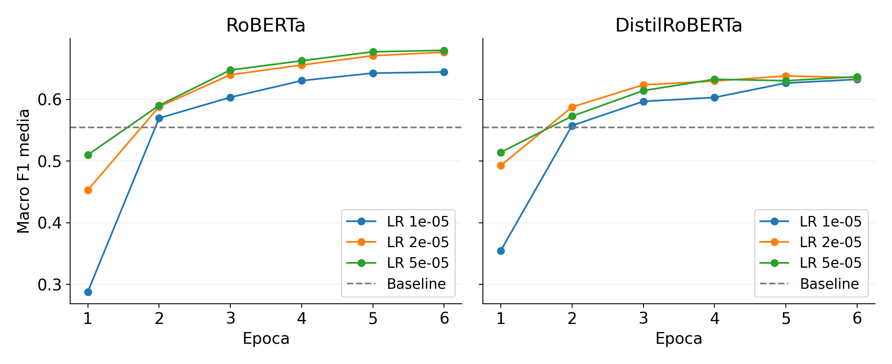
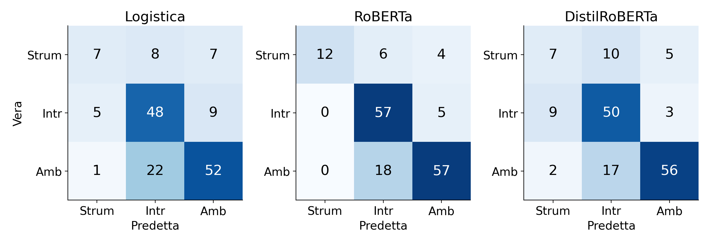
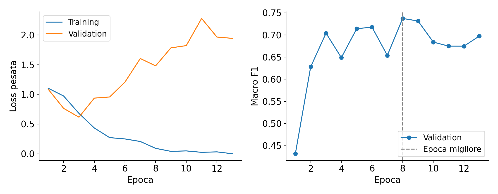

# Esperimenti di classificazione per la tesi di Ilaria

## Guida al lavoro svolto e ai risultati

Questo documento ricostruisce il percorso dagli script originali agli esperimenti eseguiti su Colab e Kaggle. Spiega quali dati sono stati usati, perché sono state confrontate più configurazioni, come sono stati scelti i parametri e quali conclusioni sostengono i risultati. I notebook e gli output sono inclusi nella consegna, così ogni numero può essere ricondotto al file che lo contiene.

Il risultato principale è che il nuovo RoBERTa, addestrato per sei epoche con learning rate 5e-5, è il modello più efficace nella valutazione finale disponibile: macro-F1 0,7705 e accuracy 0,7925 su 159 commenti. DistilRoBERTa raggiunge macro-F1 0,6251 e la baseline TF-IDF con regressione logistica 0,6043. Un successivo esperimento con una sola validation, massimo 30 epoche ed early stopping ha scelto l'epoca otto, ma non ha mostrato un miglioramento rispetto al precedente run di sei epoche sullo stesso fold e seed.

Il test era già stato usato negli esperimenti preliminari. Questa limitazione è dichiarata negli output originali e viene mantenuta nella nuova documentazione: i risultati sono informativi, ma il test non può essere descritto come mai consultato prima. L'esperimento lungo è stato eseguito dopo aver visto la valutazione finale e viene presentato come analisi aggiuntiva.

Preparazione della consegna: 10 ottobre 2026. La sequenza delle fasi segue il lavoro effettivamente svolto; non sono attribuite date di esecuzione ai run che non le registrano.

## 01 Come leggere la consegna

Per capire il processo, partire da questo documento. Per esaminare i risultati numerici, aprire i CSV di riepilogo e le predizioni nelle rispettive cartelle. Per ripetere un esperimento, importare il notebook della fase corrispondente: non è necessario eseguire tutti i notebook per leggere un risultato già disponibile.

| Cartella | Contenuto |
| --- | --- |
| 01_notebook | Quattro notebook e codice Python della prova lunga |
| 02_dati | CSV di sviluppo, supplementare e test; informazioni dello split |
| 03_risultati | Stato originale, baseline, CV parziale e completa, finale, early stopping |
| 04_documentazione | Relazione italiana, guide operative e revisioni precedenti |
| 05_script_originali | Script preesistenti copiati senza modifiche |
| 06_riproducibilita | Audit numerico e verifica degli hash dei file |
| 07_figure | Grafici italiani per la relazione |

I notebook 01 e 02 sono le ricerche su Colab. Il notebook 03 usa le selezioni già completate e allena i modelli finali su Kaggle. Il notebook 04 esegue una sola prova con validation ed early stopping. Il file Python 04 contiene lo stesso codice copiabile in una cella Kaggle. Gli script originali restano distinti dai nuovi notebook.

Le cartelle dei risultati hanno un prefisso che identifica la fase. Il nome interno dell'esperimento e i manifest sono conservati. L'archivio principale contiene dati, codice, metriche, predizioni, report, grafici e configurazioni dei checkpoint. I quattro file grandi dei pesi transformer sono anche nella cartella completa e vengono distribuiti in un secondo ZIP; estrarlo accanto alla cartella principale ripristina i percorsi dei modelli. Le baseline joblib, più piccole, sono nell'archivio principale.

## 02 Dati e suddivisione originale

Il lavoro di annotazione e preparazione dei dati precede questi nuovi esperimenti. I notebook partono dai CSV già prodotti dal progetto. Non vengono cambiate le etichette, i testi, l'appartenenza al test o le assegnazioni dei fold. Le classi si chiamano strumentale, intrinseco e ambiguo; i testi sono in inglese, anche se i nomi delle etichette sono italiani. Per le definizioni operative delle classi rimane il riferimento al protocollo di annotazione della tesi.

| Insieme | Totale | Strumentale | Intrinseco | Ambiguo |
| --- | --- | --- | --- | --- |
| Sviluppo gold | 641 | 90 | 221 | 330 |
| Supplementare | 427 | 128 | 139 | 160 |
| Training finale | 1068 | 218 | 360 | 490 |
| Test gold | 159 | 22 | 62 | 75 |

Il gold comprende 800 commenti: 641 sono nello sviluppo e 159 nel test. Il supplementare comprende 83 commenti del pilot e 344 extra. Dei 100 commenti pilot originari, 17 erano stati esclusi perché appartenenti a thread del test. Per il training finale, sviluppo e supplementare vengono uniti: 641 + 427 = 1.068 esempi.

Lo script originale `09_split_test_sviluppo_fold.py` usa StratifiedGroupKFold: cerca di mantenere proporzioni di classe simili e tiene insieme i commenti dello stesso thread. Il seed dello split, 82, era stato scelto tra 0 e 199 usando soltanto proporzioni delle classi e dimensioni dei gruppi, senza confrontare prestazioni dei modelli. Lo scarto massimo registrato dalle proporzioni complessive è 0,033. Questo seed di suddivisione è distinto dai seed usati per allenare le reti.

| Fold | Val | Thread val | Strum | Intr | Amb | Train |
| --- | --- | --- | --- | --- | --- | --- |
| 1 | 123 | 59 | 14 | 44 | 65 | 938 |
| 2 | 145 | 54 | 23 | 49 | 73 | 911 |
| 3 | 119 | 63 | 17 | 40 | 62 | 941 |
| 4 | 117 | 58 | 15 | 38 | 64 | 939 |
| 5 | 137 | 48 | 21 | 50 | 66 | 907 |

I fold non hanno dimensioni identiche perché i thread non vengono spezzati. Ogni volta che un fold è validation, i commenti supplementari dei suoi thread vengono esclusi dal training. Per esempio, usando il fold 1, il training contiene 518 gold e 420 supplementari, per un totale di 938; la validation contiene 123 gold. Sette supplementari vengono esclusi per sovrapposizione di thread.

I controlli sui dati confermano che training e test non condividono ID né thread, e che nessun thread di sviluppo compare in più fold. Non è stata effettuata un'analisi semantica di eventuali testi quasi duplicati appartenenti a thread diversi. Gli archivi Reddit grezzi e l'intero materiale di annotazione a monte non vengono ricostruiti da questa consegna: i tre CSV preparati sono il punto di partenza riproducibile degli esperimenti.

## 03 Training validation test fold seed ed epoca

Il training è l'insieme di esempi che modifica i pesi del modello. La validation è un insieme escluso da quel training, sul quale si confrontano configurazioni e durate. Il test serve a valutare le scelte già definite. Usare i risultati del test per scegliere quante epoche allenare trasforma quel test in ulteriore materiale di selezione. [Documentazione sul ruolo della validation e del test](https://scikit-learn.org/stable/modules/cross_validation.html).

Un fold è un gruppo di esempi. Con cinque fold, un run allena sui quattro gruppi di training e valuta sul gruppo rimasto. La procedura riparte da un modello nuovo per ogni fold. Non esiste un unico modello che continua ad allenarsi passando da un fold all'altro e i cinque modelli non sono stati usati come ensemble.

Un solo split train/validation consente già di scegliere durata ed early stopping. La k-fold ripete la verifica su diversi gruppi, rendendo la conclusione meno dipendente da uno specifico split. Anche una CV con parametri fissi è utile: misura la variabilità tra gruppi e può aiutare a scegliere una durata. La ricerca su più parametri aggiunge un confronto tra alternative, non rende retroattivamente inutile il lavoro precedente.

Un seed controlla parti casuali del training, come inizializzazione della testa di classificazione, ordine dei batch e dropout. Provare più seed aiuta a capire se una scelta funziona soltanto in una particolare esecuzione. I seed dei nuovi transformer sono 42, 123 e 2026, applicati ciascuno a tutti i fold.

Un'epoca è un passaggio completo sugli esempi di training. Le metriche alle epoche 1, 2, 3 e così via sono checkpoint successivi dello stesso training: non sono run indipendenti. Per verificare la variabilità del training bisogna ripartire con altri seed.

Nel training finale su tutti i 1.068 esempi non resta una validation indipendente tra quei dati. Non si può ricavare una validation indipendente semplicemente valutando un fold già visto dal modello. Il notebook 04 risolve questo punto ripartendo dal pretrained e tenendo un fold fuori dal nuovo training.

## 04 Metriche e motivo della macro F1

La precision di una classe misura quanti esempi predetti con quell'etichetta sono corretti. La recall misura quanti esempi realmente appartenenti alla classe vengono recuperati. La F1 combina precision e recall come 2 × precision × recall / (precision + recall). La macro-F1 è la media delle tre F1, con lo stesso peso per ogni classe. L'accuracy è la frazione complessiva di predizioni corrette.

La classe strumentale è meno numerosa: 90 esempi nello sviluppo e 22 nel test. Una buona accuracy può nascondere prestazioni deboli su questa classe. La macro-F1 è stata mantenuta come criterio di selezione, affiancandola a precision, recall, F1 per classe e matrici di confusione.

Un numero mostrato come 0,6794 non è una percentuale di esempi corretti: è una macro-F1. Se passa da 0,60 a 0,65, la differenza è 0,05, ossia cinque punti sulla scala 0–100. Non va confusa con un incremento relativo del 5 per cento.

La media della macro-F1 sui fold e la macro-F1 calcolata dopo aver unito tutte le predizioni fuori dal training non sono necessariamente identiche. La F1 non è lineare e i fold hanno dimensioni diverse. Quando il report usa predizioni out-of-fold aggregate, lo indica esplicitamente. Le tabelle della ricerca e le regole di selezione usano la media delle metriche dei fold.

## 05 Punto di partenza del progetto

Gli script originali valutavano una configurazione per transformer, con LR 2e-5 e un limite di sei epoche. In ogni fold registravano la macro-F1 per epoca, sceglievano il massimo locale e poi ne facevano la media. La mediana delle epoche migliori suggeriva quattro epoche per RoBERTa e cinque per DistilRoBERTa. Il seed di training era 42 più il numero del fold, quindi il fold e la casualità del training cambiavano insieme.

| Modello originale | CV registrata | Epoche finali | Macro F1 test |
| --- | --- | --- | --- |
| Regressione logistica | 0,5543 | non applicabile | 0,6043 |
| RoBERTa | 0,6854 | 4 | 0,7137 |
| DistilRoBERTa | 0,6514 | 5 | 0,6491 |

I valori CV originali dei transformer sono medie di massimi per fold. I valori dei nuovi notebook sono medie a un'unica epoca comune. Le due misure non possono essere confrontate come se usassero la stessa regola di selezione: scegliere e misurare il massimo sullo stesso fold introduce ottimismo. Questa caratteristica era già riconosciuta nei commenti del codice originale.

L'approccio originale non era privo di significato: aveva già misurato differenze tra gruppi e derivato una durata. Il nuovo lavoro rende espliciti i candidati, separa meglio l'effetto dei seed da quello dei fold, confronta durate comuni e trasferisce le scelte al training finale attraverso file di selezione, invece di modificare manualmente costanti.

Gli output originali sono inclusi come stato precedente. I relativi tempi, intervalli bootstrap e informazioni sui modelli sono conservati come registrati. Non sono stati ricostruiti l'ambiente di esecuzione originario né la validità del vecchio intervallo bootstrap; non viene usato come intervallo di incertezza per i nuovi run.

## 06 Decisioni implementative dei nuovi notebook

La richiesta pratica era eseguire gli esperimenti in cloud, senza allenare i transformer sul PC. Sono stati quindi creati due notebook Colab autonomi, anziché completare la proposta iniziale di rifattorizzare gli script CLI. Il piano iniziale è conservato come documento storico e non è la guida operativa corrente. In particolare, una prima griglia proposta conteneva 3e-5; la griglia realmente implementata contiene 5e-5.

La baseline è TF-IDF con unigrammi e bigrammi, `min_df=2`, massimo 20.000 feature, stopword inglesi e `sublinear_tf=True`. Il vocabolario viene appreso esclusivamente dal training di ogni fold. Sono confrontate regressione logistica e SVM lineare, entrambe con pesi di classe bilanciati, usando C = 0,1, 1 e 10. C regola il classificatore: valori più piccoli implicano più regolarizzazione. Non è un parametro del calcolo TF-IDF.

Per i transformer sono confrontati RoBERTa-base e DistilRoBERTa-base, con LR 1e-5, 2e-5 e 5e-5. La scala piccola riguarda il fine-tuning di un modello pretrained, non l'allenamento da zero. Questi tre valori coprono una differenza di cinque volte: costituiscono una ricerca pratica limitata, non una dimostrazione che il valore ottimale globale sia incluso nella griglia.

| Parametro | Impostazione della ricerca transformer |
| --- | --- |
| Modelli | roberta-base e distilroberta-base |
| Learning rate | 1e-5, 2e-5, 5e-5 |
| Seed | 42, 123, 2026 |
| Fold | 5 gruppi di sviluppo già assegnati |
| Epoche massime | 6 |
| Batch size | 16 |
| Lunghezza massima | 256 token |
| Ottimizzatore | AdamW |
| Weight decay | 0,01 |
| Warmup | 6 per cento dei passi previsti |
| Scheduler | Lineare con orizzonte di 6 epoche |
| Gradient clipping | Norma massima 1,0 |
| Loss | Cross entropy con pesi di classe dal training |
| Mixed precision | Attiva su CUDA |
| Seed finale | 42, stabilito prima della valutazione |

La loss usa pesi calcolati dal solo training: per la classe c, peso = N / (3 × numero di esempi della classe c). Questo aumenta il contributo relativo delle classi meno numerose. Sono mantenuti batch size e limite di testo originari. Il cap iniziale di sei epoche permette un primo confronto controllato e riprende il codice preesistente; non significa che sei epoche siano sufficienti per ogni modello.

Il messaggio di Hugging Face sui pesi `classifier.dense` e `classifier.out_proj` inizializzati da zero è atteso: il checkpoint pretrained non contiene una testa già allenata per le tre etichette della tesi. Il corpo del modello viene caricato dal pretrained e la testa viene appresa nel fine-tuning. Il warning non indica da solo un errore nel checkpoint.

Ogni run registra configurazione, dati, metriche, predizioni, versioni e dispositivo. I checkpoint pretrained vengono identificati tramite revisioni precise. Gli hash dei file di input e del codice aiutano a evitare il riuso di risultati incompatibili. I run completati possono essere saltati; un run interrotto riparte, mentre gli altri restano salvati. Il recupero non conserva lo stato dell'ottimizzatore a metà epoca.

| Modello | Revisione pretrained |
| --- | --- |
| roberta-base | e2da8e2f811d1448a5b465c236feacd80ffbac7b |
| distilroberta-base | fb53ab8802853c8e4fbdbcd0529f21fc6f459b2b |

## 07 Ricerca delle baseline su Colab

Il notebook 01 ha completato 2 famiglie × 3 valori di C × 5 fold = 30 fit. Le baseline non sono ripetute tre volte soltanto per raggiungere il conteggio dei transformer: per questa ricerca non è stata prevista una griglia di seed aggiuntiva. Il seed finale rimane 42 e i mancati raggiungimenti della convergenza vengono trattati come errori.

| Famiglia | C | Media macro F1 | SD fold |
| --- | --- | --- | --- |
| Logistica | 0,1 | 0,5468 | 0,0552 |
| Logistica | 1,0 | 0,5543 | 0,0663 |
| Logistica | 10,0 | 0,5500 | 0,0739 |
| SVM lineare | 0,1 | 0,5374 | 0,0437 |
| SVM lineare | 1,0 | 0,5377 | 0,0694 |
| SVM lineare | 10,0 | 0,5234 | 0,0640 |

La regressione logistica C=1 è la migliore baseline, con media CV 0,5543. I tre valori di C per questa famiglia danno risultati vicini. Anche per la SVM il vantaggio di C=1 rispetto a C=0,1 è minuscolo, circa 0,00038; il vincitore numerico non dimostra una superiorità netta del parametro. La baseline selezionata supera la SVM selezionata in quattro dei cinque fold, con vantaggio medio di circa 0,0166.

Sulle 641 predizioni out-of-fold della regressione logistica, la macro-F1 aggregata è 0,5518 e l'accuracy 0,6162. Le F1 per classe sono 0,3766 per strumentale, 0,5817 per intrinseco e 0,6971 per ambiguo. Strumentale recupera 29 esempi su 90, circa il 32,2 per cento: questo è uno dei limiti che motivano il confronto con i transformer.

Il file baseline CV originale registra una deviazione standard con denominatore n; il nuovo riepilogo usa la deviazione campionaria con n−1. A parità di punteggi, 0,0593 e 0,0663 possono quindi descrivere convenzioni diverse, senza implicare una differenza nei risultati dei fold.

## 08 Prima esecuzione dei transformer e limite Colab

La ricerca completa prevista era 2 modelli × 3 LR × 3 seed × 5 fold = 90 run, ciascuno con sei epoche. Le epoche vengono valutate nello stesso training: non servono sei fit distinti per confrontarle. Sono così disponibili 540 osservazioni di epoca nel run completo.

La prima esportazione, conservata nel vecchio ZIP, contiene 51 run completati: tutti i 45 RoBERTa e soltanto sei DistilRoBERTa. Per questo `complete` era false. Il riepilogo poteva selezionare RoBERTa, ma non chiudere la selezione dell'intero confronto. Il risultato RoBERTa era LR 5e-5, epoca 5, media CV 0,6823, deviazione tra fold 0,0557 e tra seed 0,0089.

Il messaggio Colab «Session limit reached» ha riguardato la disponibilità della sessione, non un fallimento della definizione dei fold o delle metriche. Dal messaggio non è stata determinata una causa tecnica più specifica. Il runner permette di continuare i run mancanti quando torna disponibile un runtime. Per impostazione predefinita esegue al massimo dieci nuovi run per sessione; questo limite può essere modificato. [FAQ sulle risorse Colab](https://research.google.com/colaboratory/faq.html).

Una seconda esportazione contiene tutti i 90 run. L'identità della griglia, i dati e i seed sono gli stessi, ma non si tratta soltanto di aggiungere 39 file immutati al primo export: tra i 51 run comuni, 45 CSV di predizioni differiscono. Le due esecuzioni vengono conservate separatamente. Ripetere gli stessi seed non aggiunge tre nuovi seed indipendenti all'esperimento.

L'impostazione dei seed non garantisce identità numerica su tutte le piattaforme e versioni. Il codice imposta i generatori casuali e alcune opzioni cuDNN, ma non forza tutti gli algoritmi deterministici PyTorch. Non è stata isolata la causa esatta delle differenze tra questi due export. [Documentazione PyTorch sulla riproducibilità](https://docs.pytorch.org/docs/2.11/notes/randomness.html).

## 09 Regola di selezione comune e run completo

Per ogni coppia LR/epoca, il notebook calcola la media della macro-F1 sulle cinque validation e sui tre seed, ossia su 15 valori. L'epoca e il LR vengono scelti insieme. Tutti i fold contribuiscono al punteggio di una configurazione alla stessa epoca. A parità esatta di media, si preferiscono meno epoche e poi il LR più basso.

Per ogni famiglia si sceglie la coppia migliore; nel confronto finale sono mantenuti la migliore baseline e i due transformer. Questa è una selezione sullo sviluppo. Il punteggio del candidato vincente può essere ottimistico dopo aver provato più alternative, quindi non viene presentato come stima finale priva di bias.

La deviazione tra fold viene calcolata dopo aver mediato i seed all'interno di ogni fold. La deviazione tra seed viene calcolata dopo aver mediato i fold all'interno di ogni seed. Entrambe sono campionarie, con denominatore n−1. I 15 valori non sono indipendenti perché i training dei fold si sovrappongono; non viene ricavato un intervallo di confidenza ingenuo trattandoli come 15 campioni indipendenti.

| Modello | Parametro | Epoca | Media CV | SD fold | SD seed |
| --- | --- | --- | --- | --- | --- |
| Logistica | C=1 | non applicabile | 0,5543 | 0,0663 | non stimata |
| RoBERTa | LR=5e-05 | 6 | 0,6794 | 0,0837 | 0,0194 |
| DistilRoBERTa | LR=2e-05 | 5 | 0,6380 | 0,0689 | 0,0273 |

RoBERTa supera DistilRoBERTa di circa 0,0415 nella media CV selezionata. Il vantaggio è positivo in tutti i cinque fold dopo aver mediato i seed, e in 13 dei 15 confronti singoli fold/seed. Questi conteggi descrivono il run, senza costituire da soli un test di significatività.

RoBERTa con LR 2e-5 a sei epoche raggiunge 0,6764, molto vicino al vincitore 5e-5 a 0,6794. Il primo ha deviazione tra seed 0,0066, contro 0,0194 del vincitore. La griglia seleziona 5e-5 perché massimizza la media, ma i dati non giustificano una forte affermazione sulla sua superiorità rispetto a 2e-5.

Il fold 4 è il più difficile per entrambe le famiglie transformer. Il miglioramento rispetto alla baseline su quel fold è ridotto. Questo mostra che la difficoltà dei thread o dei commenti cambia tra gruppi: la media da sola non descrive l'intero comportamento.

| Fold | Logistica | RoBERTa | DistilRoBERTa |
| --- | --- | --- | --- |
| 1 | 0,6589 | 0,7350 | 0,7291 |
| 2 | 0,5384 | 0,6903 | 0,6644 |
| 3 | 0,5512 | 0,7675 | 0,6531 |
| 4 | 0,5484 | 0,5514 | 0,5499 |
| 5 | 0,4748 | 0,6530 | 0,5934 |

I tempi registrati dei 45 run per famiglia sono circa 64,2 minuti per RoBERTa e 34,4 per DistilRoBERTa, su Tesla T4. Non comprendono tutto il tempo di configurazione e download. DistilRoBERTa offre un costo inferiore, ma in questa ricerca ha anche una qualità media inferiore.

Figura 1. Ogni punto è la media sui cinque fold e tre seed. Sono curve di sviluppo, non punteggi del test. Tutti i LR RoBERTa raggiungono il loro massimo osservato all'epoca sei nel secondo export, motivando la verifica successiva di una durata maggiore.

## 10 Riepilogo locale e passaggio a Kaggle

Il secondo export completo non conteneva inizialmente i riepiloghi finali. Dopo l'esaurimento dell'accesso Colab è stata eseguita localmente la cella effettiva di summary/selection del notebook 02, senza allenare altri modelli. Sono stati prodotti `run_metrics.csv`, `candidate_summary.csv`, `selected_configs.json` e le curve per modello. Il documento di selezione è completo e conserva l'hash del manifest originale.

Il passaggio a Kaggle richiedeva più di sostituire i percorsi Google Drive: il fingerprint della ricerca include le versioni software e il runtime, che su Kaggle possono differire. Per evitare di avviare involontariamente una nuova ricerca da 90 run, è stato creato il notebook 03, dedicato al training finale da selezioni congelate. Registra l'ambiente finale separatamente e mantiene la provenienza della selezione Colab.

Il file `thesis_ml_kaggle_inputs.zip` contiene i CSV preparati, i risultati della ricerca e la selezione baseline. È stato caricato come Dataset privato Kaggle. I notebook 03 e 04 rilevano automaticamente la directory `thesis_ml` cercando `bundle_manifest.json` sotto `/kaggle/input`; il percorso annidato usato nel run era compatibile. Gli output sono scritti in `/kaggle/working`.

Il riepilogo mostrato subito dopo il caricamento dei dati riportava ancora le medie CV, non nuovi punteggi test. Le celle NaN della tabella combinata erano attese: il parametro C appartiene alle baseline, LR ed epoche ai transformer, e le colonne di riepilogo dei fold differiscono.

Kaggle deve avere GPU e Internet abilitati per questo workflow. I notebook usano una sola GPU anche se il runtime ne offre due. Internet serve per dipendenze e pretrained; i checkpoint finali restano salvati nei file di output, senza pubblicazione automatica su Hugging Face. [Documentazione Kaggle sui notebook](https://www.kaggle.com/docs/notebooks), [caricamento dei dataset](https://www.kaggle.com/docs/datasets).

## 11 Training finale e risultati test

Il notebook 03 ha allenato la baseline selezionata e due nuovi transformer sui 1.068 esempi di training, usando il seed 42 stabilito in precedenza. RoBERTa ha usato LR 5e-5 per sei epoche; DistilRoBERTa LR 2e-5 per cinque. Entrambi hanno conservato lo scheduler con orizzonte di sei epoche della ricerca. Non è stato scelto un checkpoint sulla base dei risultati del test.

| Modello | Media CV | Macro F1 test | Accuracy test | Corretti su 159 |
| --- | --- | --- | --- | --- |
| Logistica | 0,5543 | 0,6043 | 0,6730 | 107 |
| RoBERTa | 0,6794 | 0,7705 | 0,7925 | 126 |
| DistilRoBERTa | 0,6380 | 0,6251 | 0,7107 | 113 |

La nuova RoBERTa classifica correttamente 126 commenti su 159; la baseline 107 e DistilRoBERTa 113. Il vantaggio macro-F1 RoBERTa è 0,1662 sulla baseline e 0,1455 su DistilRoBERTa. Sono differenze descrittive di un seed e un test, senza dichiarazione di significatività statistica.

| Modello | Classe | Precision | Recall | F1 | Supporto |
| --- | --- | --- | --- | --- | --- |
| Logistica | strumentale | 0,5385 | 0,3182 | 0,4000 | 22 |
| Logistica | intrinseco | 0,6154 | 0,7742 | 0,6857 | 62 |
| Logistica | ambiguo | 0,7647 | 0,6933 | 0,7273 | 75 |
| RoBERTa | strumentale | 1,0000 | 0,5455 | 0,7059 | 22 |
| RoBERTa | intrinseco | 0,7037 | 0,9194 | 0,7972 | 62 |
| RoBERTa | ambiguo | 0,8636 | 0,7600 | 0,8085 | 75 |
| DistilRoBERTa | strumentale | 0,3889 | 0,3182 | 0,3500 | 22 |
| DistilRoBERTa | intrinseco | 0,6494 | 0,8065 | 0,7194 | 62 |
| DistilRoBERTa | ambiguo | 0,8750 | 0,7467 | 0,8058 | 75 |

La classe strumentale spiega una parte importante del vantaggio di RoBERTa. Il modello la predice dodici volte e tutte le dodici sono corrette, quindi la precision osservata è 1,00. Tuttavia ci sono 22 commenti strumentali e dieci vengono mancati: recall 12/22 = 0,5455. La precision perfetta su dodici predizioni non garantisce lo stesso comportamento su nuovi dati. Baseline e DistilRoBERTa recuperano ciascuna sette dei 22 commenti.

Per intrinseco RoBERTa recupera 57 commenti su 62, per ambiguo 57 su 75. L'errore più frequente è assegnare intrinseco a 18 commenti ambiguo. La classe ambiguo ha F1 simile tra RoBERTa e DistilRoBERTa; la differenza maggiore tra le due reti emerge su strumentale.

Figura 2. Righe = etichetta vera, colonne = etichetta predetta. Gli stessi 159 commenti sono usati per i tre modelli. La diagonale indica le predizioni corrette.

Confrontando i report precedenti e nuovi sullo stesso test, la baseline rimane a 0,6043; DistilRoBERTa passa da 0,6491 a 0,6251; RoBERTa da 0,7137 a 0,7705. Questi confronti documentano il percorso, ma non sono un'ablazione che attribuisca le differenze a una singola modifica: cambiano configurazioni e condizioni di esecuzione. Non tutti i modelli migliorano con il nuovo workflow.

La macro-F1 test più alta della media CV per RoBERTa può dipendere da composizione del test, maggiore quantità di training, seed e altre differenze. Non dimostra che la CV fosse inutile né permette di isolare la causa dell'aumento. Il test contiene 71 thread e soltanto 22 esempi della classe meno numerosa.

Gli output finali registrano soltanto training loss durante le epoche. La loss RoBERTa scende da circa 0,997 a 0,071, ma senza validation indipendente questo non prova né che servano altre epoche né che una durata maggiore migliori la generalizzazione. Da questo dubbio nasce l'esperimento seguente.

## 12 Esperimento lungo con una sola validation

Le epoche finali su Kaggle richiedevano circa 10–15 secondi, rendendo ragionevole provare un cap più alto. Non era obbligatorio ripetere l'intera k-fold: per un esperimento iniziale bastava una sola validation indipendente dal nuovo training. Il notebook 04 tiene fuori il fold 1 e avvia un RoBERTa fresco dal pretrained, anziché proseguire il checkpoint che aveva già visto tutti i commenti di sviluppo.

Le impostazioni sono: LR 5e-5, seed 42, massimo 30 epoche, patience 5, monitor validation macro-F1 e salvataggio del checkpoint a ogni miglioramento stretto. A parità esatta viene mantenuta l'epoca precedente. Il test non viene letto. La loss di validation è calcolata con gli stessi pesi di classe derivati dal training.

Early stopping significa interrompere dopo un numero prestabilito di epoche senza miglioramento della metrica scelta. Il modello da conservare è il miglior checkpoint, non necessariamente l'ultimo. Nel notebook questa regola è implementata nel loop PyTorch; non viene usata una callback Keras. [Definizione di patience e ripristino del migliore checkpoint](https://keras.io/api/callbacks/early_stopping/).

Il nuovo scheduler copre 30 epoche e il warmup è il 6 per cento di quell'orizzonte. Questo cambia la traiettoria rispetto allo scheduler di sei epoche: allenare otto epoche lungo un orizzonte di 30 non equivale ad allenarne otto lungo un orizzonte di otto. Una semplice sostituzione del numero di epoche nel notebook finale precedente non riproduce questa configurazione.

| Epoca | Loss train | Loss val | Macro F1 val | Accuracy val | Attesa |
| --- | --- | --- | --- | --- | --- |
| 1 | 1,1025 | 1,0845 | 0,4319 | 0,5772 | 0 |
| 2 | 0,9723 | 0,7639 | 0,6281 | 0,6748 | 0 |
| 3 | 0,6795 | 0,6161 | 0,7042 | 0,7398 | 0 |
| 4 | 0,4342 | 0,9371 | 0,6489 | 0,6911 | 1 |
| 5 | 0,2716 | 0,9564 | 0,7142 | 0,7480 | 0 |
| 6 | 0,2494 | 1,2069 | 0,7178 | 0,7642 | 0 |
| 7 | 0,2066 | 1,6044 | 0,6539 | 0,6911 | 1 |
| 8 | 0,0911 | 1,4806 | 0,7374 | 0,7561 | 0 |
| 9 | 0,0401 | 1,7838 | 0,7317 | 0,7967 | 1 |
| 10 | 0,0478 | 1,8218 | 0,6840 | 0,7154 | 2 |
| 11 | 0,0238 | 2,2793 | 0,6749 | 0,7154 | 3 |
| 12 | 0,0316 | 1,9660 | 0,6748 | 0,7073 | 4 |
| 13 | 0,0002 | 1,9443 | 0,6975 | 0,7480 | 5 |

Il massimo è all'epoca 8, macro-F1 0,7374 e accuracy 0,7561. Le epoche 9, 10, 11, 12 e 13 non superano quel massimo; dopo la quinta il training si arresta correttamente. Il checkpoint disponibile è quello dell'epoca 8. Il tempo delle epoche registrate, inclusi validation e scrittura dei checkpoint, è circa 193 secondi.

All'interno di questo run, epoch 6 = 0,7178 ed epoch 8 = 0,7374: il miglioramento è 0,0196, quasi due punti. La prova ha quindi mostrato che non era necessario fermarsi rigidamente a sei in questa traiettoria, e ha anche mostrato che proseguire fino all'ultima epoca osservata avrebbe dato un punteggio inferiore.

Figura 3. La linea verticale indica l'epoca 8, selezionata dalla validation macro-F1. La loss di validation raggiunge il minimo prima, all'epoca 3. Sono metriche diverse e non devono necessariamente scegliere lo stesso checkpoint.

La loss di training arriva vicino a zero, mentre quella di validation aumenta dopo l'epoca 3: è un segnale di overfitting e/o predizioni errate sempre più sicure. La macro-F1 può temporaneamente migliorare anche se la cross-entropy peggiora, perché considera le etichette predette e non quanto il modello sia sicuro. All'epoca 9 l'accuracy è superiore a quella dell'epoca 8, ma la macro-F1 è inferiore: è corretto conservare l'epoca 8 per il criterio stabilito.

La verifica più importante confronta lo stesso fold, LR e seed nel precedente export CV completo: il run RoBERTa, fold 1, seed 42, LR 5e-5 raggiungeva già 0,7389 all'epoca 6. Il nuovo migliore 0,7374 è praticamente equivalente, leggermente inferiore. Cambiano scheduler e build CUDA/PyTorch; non si può attribuire la differenza soltanto al numero di epoche. Non è dimostrato un guadagno sul precedente risultato equivalente.

Alla migliore epoca, le F1 sono 0,6875 per strumentale, 0,7312 per intrinseco e 0,7934 per ambiguo. Le recall corrispondono a 11/14, 34/44 e 48/65 esempi. Questi 123 commenti di validation non sono i 159 del test: 0,7374 validation non deve essere confrontato direttamente con 0,7705 test come se fosse una classifica tra checkpoint.

## 13 Cosa si può concludere

La nuova ricerca rende tracciabili parametri, seed, durata e dati. Sullo sviluppo RoBERTa è il modello più forte tra le alternative provate e sul test finale la sua superiorità descrittiva è confermata. DistilRoBERTa è più veloce, ma non offre lo stesso livello di qualità in questi run. C cambia poco le prestazioni delle baseline nella griglia disponibile.

La scelta di sei epoche era un cap iniziale verificabile, non una legge sul fine-tuning. La prova lunga è stata sensata e ha prodotto un checkpoint selezionato a otto, con arresto a tredici. Nel confronto con la precedente prova equivalente non emerge un beneficio sostanziale. Non ci sono risultati di questo esperimento che dimostrino un vantaggio nel forzare 20 o 30 epoche sotto queste impostazioni; l'early stopping non esclude matematicamente qualsiasi possibile recupero successivo.

Rimane utile conservare entrambi i checkpoint: il RoBERTa finale allenato su tutti i 1.068 esempi e valutato sul test, e il RoBERTa del nuovo esperimento con 938 training e 123 validation. Hanno funzioni diverse e nessuno viene rinominato in modo da nasconderne la provenienza.

La ricerca finale usa tre seed nella CV, ma un solo seed per il training finale e uno per la prova lunga. I punteggi non rappresentano la distribuzione completa delle prestazioni possibili. Non sono stati eseguiti nested CV, una ricerca esaustiva su tutti gli iperparametri, un confronto controllato del solo scheduler, o un nuovo test indipendente. Sono possibili estensioni, non passaggi mancanti che annullino i risultati ottenuti.

## 14 Come usare o ripetere il lavoro

Per leggere i risultati non serve GPU: aprire i report HTML o Word, i CSV e le figure. Per rifare la ricerca baseline, usare il notebook 01 con i tre CSV nelle directory Drive descritte nel README Colab. Per la ricerca transformer, usare il notebook 02 con GPU. Questa consegna conserva sia il primo export parziale sia il secondo completo: non unirli per trattarli come un'unica esecuzione con più seed.

Per il training finale Kaggle, caricare `thesis_ml_kaggle_inputs.zip` come Dataset privato, importare notebook 03, collegare il Dataset con Add Input e abilitare GPU e Internet. I parametri vengono letti dalla selezione Colab. Per ripetere la prova lunga, importare notebook 04 e collegare lo stesso Dataset; le impostazioni sono nel dizionario CONFIG. Non è necessario rigenerare i fold o caricare altri dati.

Per continuare un notebook 02 interrotto, rilanciare la ricerca sullo stesso esperimento e ambiente: i run completati validi vengono saltati. Se la configurazione, i dati o l'ambiente cambiano, il fingerprint può creare un esperimento nuovo. Il notebook finale Kaggle registra correttamente questa distinzione invece di fingere di condividere l'ambiente Colab.

Salvare una versione Kaggle con i file di output abilitati, controllare che i checkpoint compaiano nell'Output della versione salvata e scaricarli prima di chiudere la sessione. Quick Save con salvataggio degli output conserva un'esecuzione interattiva; Save & Run All avvia invece una nuova esecuzione. Le istruzioni dettagliate sono incluse nel README Kaggle.

Per l'inferenza usare il percorso esplicito del checkpoint desiderato. Con AutoTokenizer e AutoModelForSequenceClassification, caricare la directory che contiene config, tokenizer e pesi, troncare il testo a 256 token e leggere l'etichetta da `model.config.id2label`. Gli script originali di applicazione al corpus possono contenere percorsi verso il vecchio checkpoint: vanno verificati prima di applicare un nuovo modello. La nuova applicazione all'intero corpus non è stata eseguita in questo lavoro.

Se si decidesse di rifare il training su tutti i 1.068 esempi usando la durata di otto ricavata dalla prova lunga, preservare LR e scheduler con orizzonte 30 per riprodurre la configurazione. Questo training aggiuntivo non è stato eseguito. Il modello finale corrente resta il RoBERTa a sei epoche con la selezione originale del nuovo workflow.

## 15 Verifiche e tracciabilità

I notebook sono stati validati come file e controllati per sintassi. Le parti di training, selezione e salvataggio sono state provate localmente con dati sintetici e piccole reti RoBERTa create appositamente, incluse durata selezionata, reload dei checkpoint, ripresa dei run completati, gestione dei pareggi ed early stopping. I training ufficiali full-size sono quelli eseguiti dall'utente su Colab e Kaggle e documentati dai loro output.

Le verifiche sui risultati ricalcolano F1 e accuracy dalle predizioni CSV, confrontano ID ed etichette con i dati di riferimento, controllano gli hash, i confini tra thread e la coerenza tra manifest e selezioni. La CV completa ha 90 run e 540 record di epoca verificati. Le metriche delle tre valutazioni finali e del checkpoint holdout coincidono con i CSV ricalcolati.

La presenza e dimensione dei file dei pesi, la configurazione delle etichette e la coerenza dei report sono state controllate. Non è stata rieseguita l'inferenza full-size dei checkpoint scaricati per confrontare ogni logit con gli output, né sono stati caricati i joblib ricevuti. Lo script di audit della consegna consente di ripetere i controlli numerici senza usare GPU o caricare i modelli.

Le cartelle includono anche le spiegazioni di revisione prodotte per ciascuna fase. I file inglesi originali sono mantenuti come documentazione tecnica; questa relazione in italiano è la ricostruzione unificata. `INVENTARIO.csv` riporta percorsi, dimensioni, hash e archivio di distribuzione. Lo script di integrità verifica i file estratti e segnala separatamente i pesi grandi eventualmente non ancora estratti.

## 16 Indicazioni per la scrittura della tesi

Descrivere prima i dati e la separazione per thread, poi la griglia fissata, il criterio di selezione a epoca comune e infine il training finale. Presentare risultati per classe accanto alla macro-F1, soprattutto per strumentale. Specificare seed, runtime e versioni; indicare che le ripetizioni non garantiscono identità numerica tra ambienti.

Separare le tabelle dei risultati originali, della CV nuova, del test finale e della prova lunga. Le differenze di metodo sono parte della spiegazione e non vanno nascoste facendo una singola classifica di tutti i punteggi. Le deviazioni standard tra fold e tra seed sono descrittive e non intervalli di confidenza.

Una formulazione fedele per il risultato finale è: «Nel confronto finale sulle stesse 159 osservazioni, RoBERTa ha ottenuto macro-F1 0,771, contro 0,625 di DistilRoBERTa e 0,604 della baseline. Le configurazioni sono state selezionate sullo sviluppo con cinque fold raggruppati per thread e tre seed per i transformer. Il training finale ha usato il seed 42. Il test era già stato consultato negli esperimenti preliminari, per cui non costituisce un holdout completamente intatto».

Per la prova lunga: «Un'analisi aggiuntiva con una validation fissa, cap di 30 epoche e patience 5 ha selezionato l'epoca 8 e arrestato il training all'epoca 13. Il punteggio validation 0,737 è risultato equivalente al precedente 0,739 sul medesimo fold e seed, con un diverso orizzonte dello scheduler. L'esperimento non ha fornito evidenza di un miglioramento sostanziale dovuto a una durata maggiore».

Queste frasi sono suggerimenti da adattare al capitolo e alla terminologia della tesi, senza introdurre pretese di generalizzazione o significatività non verificate.

## 17 Appendice con tutti i candidati transformer

La tabella seguente riporta i 36 candidati LR/epoca del secondo export completo. Ciascuna media usa cinque fold e tre seed. Il CSV originale include anche le cinque medie per fold e le tre medie per seed; i file dei singoli run permettono di risalire a ogni predizione per ogni epoca.

| Modello | LR | Epoca | Media CV | SD fold | SD seed |
| --- | --- | --- | --- | --- | --- |
| DistilRoBERTa | 1e-05 | 1 | 0,3550 | 0,0950 | 0,0044 |
| DistilRoBERTa | 1e-05 | 2 | 0,5575 | 0,0639 | 0,0224 |
| DistilRoBERTa | 1e-05 | 3 | 0,5968 | 0,0607 | 0,0129 |
| DistilRoBERTa | 1e-05 | 4 | 0,6032 | 0,0674 | 0,0253 |
| DistilRoBERTa | 1e-05 | 5 | 0,6265 | 0,0801 | 0,0118 |
| DistilRoBERTa | 1e-05 | 6 | 0,6324 | 0,0766 | 0,0145 |
| DistilRoBERTa | 2e-05 | 1 | 0,4927 | 0,0466 | 0,0428 |
| DistilRoBERTa | 2e-05 | 2 | 0,5876 | 0,0757 | 0,0244 |
| DistilRoBERTa | 2e-05 | 3 | 0,6235 | 0,0719 | 0,0232 |
| DistilRoBERTa | 2e-05 | 4 | 0,6297 | 0,0789 | 0,0142 |
| DistilRoBERTa | 2e-05 | 5 | 0,6380 | 0,0689 | 0,0273 |
| DistilRoBERTa | 2e-05 | 6 | 0,6352 | 0,0756 | 0,0181 |
| DistilRoBERTa | 5e-05 | 1 | 0,5142 | 0,0530 | 0,0296 |
| DistilRoBERTa | 5e-05 | 2 | 0,5728 | 0,0468 | 0,0212 |
| DistilRoBERTa | 5e-05 | 3 | 0,6142 | 0,0561 | 0,0412 |
| DistilRoBERTa | 5e-05 | 4 | 0,6326 | 0,0690 | 0,0105 |
| DistilRoBERTa | 5e-05 | 5 | 0,6303 | 0,0597 | 0,0205 |
| DistilRoBERTa | 5e-05 | 6 | 0,6367 | 0,0697 | 0,0125 |
| RoBERTa | 1e-05 | 1 | 0,2881 | 0,0646 | 0,0265 |
| RoBERTa | 1e-05 | 2 | 0,5696 | 0,0494 | 0,0091 |
| RoBERTa | 1e-05 | 3 | 0,6033 | 0,0622 | 0,0310 |
| RoBERTa | 1e-05 | 4 | 0,6303 | 0,0602 | 0,0216 |
| RoBERTa | 1e-05 | 5 | 0,6426 | 0,0659 | 0,0112 |
| RoBERTa | 1e-05 | 6 | 0,6444 | 0,0715 | 0,0129 |
| RoBERTa | 2e-05 | 1 | 0,4530 | 0,0197 | 0,0896 |
| RoBERTa | 2e-05 | 2 | 0,5881 | 0,0465 | 0,0304 |
| RoBERTa | 2e-05 | 3 | 0,6398 | 0,0681 | 0,0194 |
| RoBERTa | 2e-05 | 4 | 0,6557 | 0,0647 | 0,0207 |
| RoBERTa | 2e-05 | 5 | 0,6708 | 0,0730 | 0,0035 |
| RoBERTa | 2e-05 | 6 | 0,6764 | 0,0765 | 0,0066 |
| RoBERTa | 5e-05 | 1 | 0,5100 | 0,0757 | 0,0486 |
| RoBERTa | 5e-05 | 2 | 0,5901 | 0,0551 | 0,0217 |
| RoBERTa | 5e-05 | 3 | 0,6475 | 0,0602 | 0,0216 |
| RoBERTa | 5e-05 | 4 | 0,6626 | 0,0783 | 0,0122 |
| RoBERTa | 5e-05 | 5 | 0,6771 | 0,0750 | 0,0141 |
| RoBERTa | 5e-05 | 6 | 0,6794 | 0,0837 | 0,0194 |

## 18 Ambienti e riferimenti

| Fase | Python | Pandas | PyTorch | Transformers | CUDA |
| --- | --- | --- | --- | --- | --- |
| CV transformer Colab | 3.13.15 | 2.2.3 | 2.11.0+cu130 | 4.57.1 | 13.0 |
| Finale Kaggle | 3.13.15 | 2.3.3 | 2.11.0+cu128 | 4.57.1 | 12.8 |
| Holdout Kaggle | 3.13.15 | 2.3.3 | 2.11.0+cu128 | 4.57.1 | 12.8 |

Il manifest della ricerca baseline registra Python 3.13.16 e scikit-learn 1.6.1. Il passaggio Colab/Kaggle conserva dati, revisioni pretrained e scelte, ma cambia parte dell'ambiente numerico. Per l'ambiente originale degli script precedenti non è disponibile un manifest equivalente.

Le fonti principali dei risultati sono i file inclusi nella consegna. Per le definizioni e l'uso degli strumenti sono consultabili i riferimenti tecnici già richiamati: documentazione scikit-learn su training, validation e gruppi; PyTorch 2.11 sulla riproducibilità; Keras sulla semantica di early stopping; FAQ Colab sulle risorse; documentazione Kaggle sui notebook e dataset. La scheda pretrained è disponibile su [Hugging Face RoBERTa](https://huggingface.co/FacebookAI/roberta-base). Queste fonti descrivono gli strumenti; i numeri sperimentali provengono dai run allegati.
